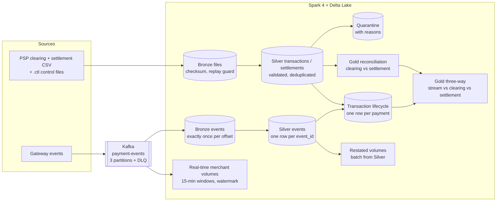

# Payment Acquiring, Processing and Reconciliation Platform

[](https://github.com/krishnanram223-cell/payment-recon-platform/actions/workflows/ci.yml)


Every card payment is reported three times: as a real-time event when the card is tapped,
in the PSP's end-of-day **clearing** file, and in the **settlement** file when the money
actually moves. When those three disagree, somebody is losing money.

This project ingests all three channels into a Delta Lake lakehouse, keeps one record per
payment, and reconciles stream vs clearing vs settlement. Every break gets a status and a
reason. I work with acquiring data in my day job; this is my own end-to-end rebuild of that
world with batch **and** streaming, on synthetic data.

## Architecture



## What it does

| Layer | Job | Guarantees |
|---|---|---|
| Bronze (files) | `ingestion/bronze.py` | file name, control file, SHA-256 and record count checked; each file loaded once; crash-safe rewrite with `replaceWhere`; audit row per file |
| Silver (batch) | `transform/silver.py` | typed with ANSI-safe `try_` casts; first failing rule becomes the quarantine reason; in-file and cross-file duplicates removed; insert-only MERGE |
| Gold | `gold/reconciliation.py` | one status per key: MATCHED, PENDING / MISSING_SETTLEMENT (settlement window), DUPLICATE, AMOUNT / CURRENCY mismatch, ORPHAN, UNEXPECTED; merchant daily summary |
| Streaming | `streaming/stream_to_bronze.py` | Kafka to Bronze (MERGE on topic/partition/offset) and Silver (MERGE on `event_id`), dead-letter queue, checkpoints, `availableNow` or continuous |
| Lifecycle | `transform/lifecycle.py` | one row per payment filled by both channels; same result in any arrival order; Delta-to-Delta streaming; retries on concurrent commits |
| Three-way | `gold/three_way.py` | separate stream and settlement verdicts; clearing window (PENDING vs MISSING_IN_CLEARING) |
| Real-time volumes | `streaming/merchant_volumes.py` | 15-minute windows, watermark, `dropDuplicatesWithinWatermark`, append mode, dropped-row metric |
| Restatement | `gold/volume_restatement.py` | recomputes the same windows from Silver and reports exactly what the stream missed |

## How correctness is proven

The generators plant known defects (invalid rows, duplicates, late files, missing / wrong /
duplicate settlements, missing and ghost events, late and re-sent events) and write their ids
to an answer key the pipeline never reads. The tests compare each layer's output with that
key id by id, and also check idempotence, crash recovery and arrival-order independence.

Results on the default data set (3 days, 3 PSPs, seed 42):

| Check | Result |
|---|---|
| Silver | 8,610 rows in, 8,355 inserted, 255 quarantined (all planted) |
| Clearing vs settlement | 3,855 MATCHED; 45 each of MISSING, AMOUNT_MISMATCH, DUPLICATE, ORPHAN |
| Kafka | 4,365 messages, 4,320 unique events, 45 re-sends removed |
| Stream vs clearing | 4,275 MATCHED, 45 MISSING_IN_STREAM, 45 MISSING_IN_CLEARING |
| Test suite | 50 tests passing |

## Run it

Open the repo in **GitHub Codespaces** (the dev container installs Python 3.12, Java 17 and
Docker), or on any Linux machine with those installed:

```bash
pip install -r requirements-dev.txt && pip install -e .
docker compose up -d kafka

# batch
python -m payrecon.generator.generate_psp_files --start-date 2026-10-19 --days 3
python -m payrecon.ingestion.bronze
python -m payrecon.transform.silver
python -m payrecon.gold.reconciliation --as-of-date 2026-12-31

# streaming
python -m payrecon.generator.generate_events
python -m payrecon.streaming.admin create
python -m payrecon.streaming.producer --rate 0
python -m payrecon.streaming.stream_to_bronze --available-now

# both channels together
python -m payrecon.transform.lifecycle
python -m payrecon.gold.three_way --as-of-date 2026-12-31
python -m payrecon.streaming.merchant_volumes --available-now
python -m payrecon.gold.volume_restatement

python -m payrecon.tools.show_tables      # look at every table
```

Tests:

```bash
python -m pytest -q -m "not kafka and not slow"   # fast set, a few minutes
python -m pytest -q                               # everything (Kafka running, Kafka UI stopped)
```

## Repository layout

```
src/payrecon/
  schemas/contracts.py        data contracts: columns, types, allowed values
  generator/                  synthetic PSP files, gateway events, answer keys
  common/                     paths, Spark session, Delta helpers
  ingestion/bronze.py         file ingestion
  transform/                  Silver and the transaction lifecycle
  gold/                       reconciliation, three-way, restatement
  streaming/                  Kafka admin, producer, consumer demo, streaming jobs
  tools/show_tables.py        read-only overview of every table
tests/                        50 tests against the answer keys
docs/                         architecture and design decisions
```

## Design notes

- [docs/DESIGN_DECISIONS.md](docs/DESIGN_DECISIONS.md): why each layer works the way it does, and two incidents I debugged along the way
- [docs/architecture.md](docs/architecture.md): target architecture including the Snowflake warehouse
- [PROGRESS.md](PROGRESS.md): milestone log

## Roadmap

- [x] Batch lakehouse: Bronze, Silver, Gold reconciliation
- [x] Kafka + Structured Streaming with exactly-once Delta sinks
- [x] Lifecycle and three-way reconciliation
- [x] Watermarked real-time volumes with batch restatement
- [ ] Snowflake star schema and loads (dbt)
- [ ] Deployment on Databricks with Workflows
- [ ] Monitoring and alerting on break volumes and dropped events

All data is synthetic. Card numbers are masked public test BINs; no real card or customer data is used.
