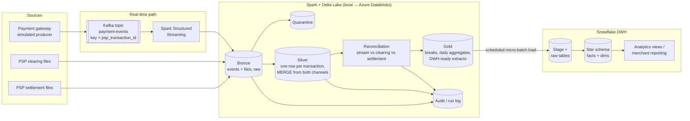

# Architecture — Real-Time Payment Acquiring, Processing and Reconciliation Platform (v2)

v2 is a new build in the same domain as an earlier AWS + Databricks file-processing
project (v1, kept separately). v2 focuses on three things:

1. **Real-time** payment events (Kafka → Spark Structured Streaming)
2. **Batch** PSP clearing and settlement files
3. **Snowflake** as the analytical data warehouse (Kimball star schema)

## 1. Business problem

An acquirer sees each payment three times:

| Moment | Source | Channel | Purpose |
|---|---|---|---|
| Authorisation (seconds) | Gateway / PSP events | **Stream** (Kafka) | Intraday visibility: volumes, decline spikes, fraud signals |
| Clearing (end of day) | PSP clearing file | **Batch** | Authoritative record of what will be charged |
| Settlement (T+1) | PSP settlement file | **Batch** | What money actually moved, fees, net amount |

The platform must merge these into one view of each transaction without double
counting, detect where they disagree, and publish clean analytical data to the warehouse.

## 2. Target architecture

## 3. Component responsibilities and trade-offs

| Component | Responsibility | Why / trade-off |
|---|---|---|
| Kafka | Durable, ordered, replayable event log | Keying by `psp_transaction_id` keeps all events of a transaction in one partition (ordering). Adds ops complexity; run in Docker locally. |
| Spark Structured Streaming | Read Kafka, parse, validate, write Bronze/Silver with checkpoints | Same engine and code style as batch. Micro-batch latency (seconds), not milliseconds — fine for monitoring. |
| Spark batch | Ingest clearing/settlement files | Files are the authoritative financial record. |
| Delta Lake | Bronze/Silver/Gold storage, MERGE, time travel | MERGE on the business key is what makes batch + stream idempotent. |
| Snowflake | DWH: conformed star schema for analysts and finance | Separation of engineering and serving; costs credits per running warehouse, so load in scheduled micro-batches rather than continuously. |
| Azure Databricks (later) | Hosted runtime for the same Spark code | Developed locally first; deployed once logic is proven. |

**Why not load Snowflake in real time?** It's possible (Kafka connector / Snowpipe
Streaming), but a DWH serves analytical questions that rarely need second-level
freshness, and continuous loading keeps compute running. Real-time monitoring reads
Delta Gold; Snowflake gets data every N minutes/hours. This is a deliberate trade-off
we can revisit.

## 4. Data contracts

### 4.1 Real-time payment event (Kafka, JSON — Avro/Schema Registry later)

| Field | Type | Rule |
|---|---|---|
| event_id | string (UUID) | unique per event — used to drop duplicate deliveries |
| event_type | string | `AUTHORISED`, `DECLINED`, `CAPTURED`, `REFUNDED`, `REVERSED` |
| event_timestamp | timestamp UTC | event time — drives watermarks |
| produced_at | timestamp UTC | producer time — measures lag |
| psp_code, psp_transaction_id | string | business key (also the Kafka message key) |
| merchant_id, terminal_id | string | |
| amount | decimal(18,2) | > 0 |
| currency, card_scheme, masked_pan, entry_mode | string | as in clearing file |
| schema_version | int | enables schema evolution |

### 4.2 PSP clearing file — `{PSP}_TXN_{YYYYMMDD}_{seq}.csv` + `.ctl`
See `src/payrecon/schemas/contracts.py` (`TRANSACTION_FIELDS`).

### 4.3 PSP settlement file — `{PSP}_STL_{YYYYMMDD}_{seq}.csv` + `.ctl`
See `SETTLEMENT_FIELDS`. `gross_amount` is signed (refunds negative).

### 4.4 Control file `.ctl`
`file_name`, `record_count`, `sha256` — file-level completeness and replay guard.

## 5. Combining batch and stream without double counting

* Bronze keeps every record from both channels, tagged `source_channel` (`STREAM` / `BATCH`).
* Silver `transactions` has **one row per `(psp_code, psp_transaction_id)`**, written with MERGE:
  * stream inserts first (provisional status), batch clearing confirms it (`cleared = true`);
  * lineage columns: `seen_in_stream`, `seen_in_clearing`, `first_seen_ts`, `source_file`.
* Duplicate Kafka deliveries are removed by `event_id`; duplicate file rows by business key.
* All counts and amounts are computed from Silver, never Bronze.

## 6. Reconciliation

| Check | Break types |
|---|---|
| Stream ↔ clearing | `MISSING_IN_CLEARING` (authorised, never cleared), `MISSING_IN_STREAM` (cleared, event never seen), `AMOUNT_DIFF_STREAM_CLEARING` |
| Clearing ↔ settlement (implemented, milestone 1.4) | `MATCHED`, `PENDING_SETTLEMENT` (inside the settlement window), `MISSING_SETTLEMENT`, `ORPHAN_SETTLEMENT`, `UNEXPECTED_SETTLEMENT` (declined but settled), `DUPLICATE_SETTLEMENT`, `CURRENCY_MISMATCH`, `AMOUNT_MISMATCH` |
| Row validation | quarantine reasons (`MISSING_MANDATORY_FIELD`, `INVALID_CURRENCY`, `INVALID_AMOUNT`, `INVALID_TIMESTAMP`) |

Late data: reconciliation runs over a rolling window (D-2..D) and re-opens/closes breaks
rather than judging a day once.

## 7. Snowflake DWH model (Kimball)

| Table | Grain |
|---|---|
| `dim_merchant` (SCD type 2) | one row per merchant version |
| `dim_psp`, `dim_card_scheme`, `dim_date` | one row per member |
| `fact_transaction` | one row per unique transaction |
| `fact_settlement` | one row per settlement line |
| `fact_recon_break` | one row per break, with status open/resolved |
| `fact_merchant_daily` (periodic snapshot) | one row per merchant per business date |

Load path: Gold → Parquet in a stage → `COPY INTO` raw tables → `MERGE` into the star
schema (idempotent). Details in Phase 4.

## 8. Main technical challenges

1. Idempotency across re-runs, Kafka redelivery and file resends → MERGE on business key, processed-file log, event_id dedup, streaming checkpoints.
2. Late and out-of-order events → event-time watermarks + rolling reconciliation window.
3. Two channels, one truth → Silver lineage flags; batch clearing is authoritative for money.
4. Money semantics → Decimal only; normalise refund sign before comparing.
5. PCI scope → masked PANs only, never full card numbers.
6. Cost → everything runs locally until Phase 4; cloud trials are started only when needed and torn down after.
